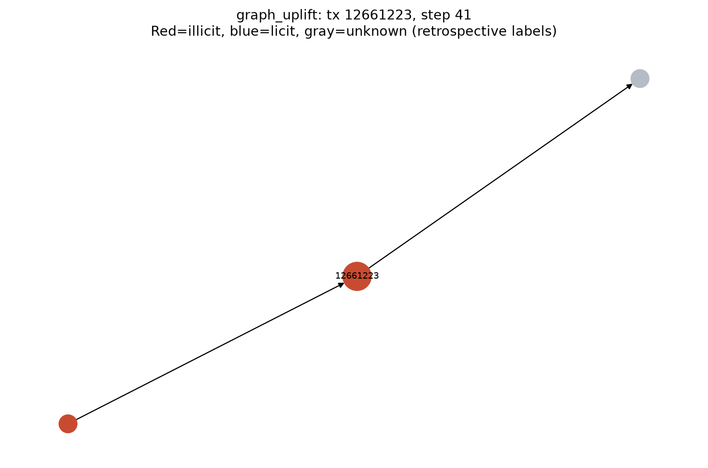
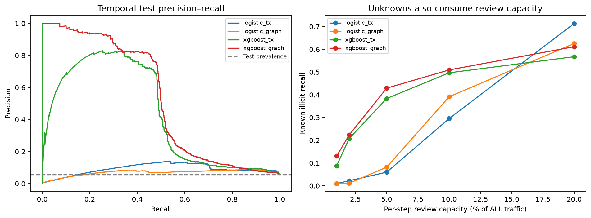

# FraudGraph

**Can a Bitcoin transaction look ordinary on its own—but different once you follow its connections?**

FraudGraph is an **independent, end-to-end machine learning research project** exploring whether transaction-network features improve fraud-risk *ranking*, and whether those improvements survive changes over time. It uses the [Elliptic++ Bitcoin transaction dataset](https://github.com/git-disl/EllipticPlusPlus), not live wallets or payment traffic.

## Why I built it

I've long been curious about how Bitcoin works, even though I haven't worked with it directly. When I started looking for a fraud-detection project, I wanted to move beyond the familiar tabular credit-card fraud datasets and challenge myself with something less straightforward: **money flows, connected transactions, incomplete labels, and models that might fail over time**.

The research, analysis, and applications here are my **independent work**.

## Explore the two apps

Both apps tell the **same evidence-backed FraudGraph story** in different ways. Choose whichever suits you:

### 1. [FraudGraph Investigator — Open the app](https://thizisfranklin.github.io/FraudGraph/investigator/)

**Prefer a straightforward analyst workspace? Start here.**

Explore **101 real Elliptic++ case examples**, inspect directed transaction neighborhoods, compare saved transaction-only and graph-enhanced model scores, and take/export case notes. It's a retrospective investigation demo—not a live Bitcoin wallet checker or a fraud-verdict system.

[**Launch Investigator →**](https://thizisfranklin.github.io/FraudGraph/investigator/) · [App source](app/) 

### 2. [Neon Ledger City — Open the interactive story](https://thizisfranklin.github.io/FraudGraph/)

**In the mood for a more cinematic, game-inspired experience? Start here.**

This is the same research told through a neon-city, interactive story with real graphs, model comparisons, analyst-review tradeoffs, and the surprising decline in later-period performance. I drew visual inspiration from the *Grand Theft Auto* series' atmosphere and retro-city styling, while creating **original artwork and UI**—no Rockstar branding, music, game assets, or characters.

[**Enter Neon Ledger City →**](https://thizisfranklin.github.io/FraudGraph/) · [Story source](story/)

> **Same underlying study, different experiences:** Investigator is the practical workbench; Neon Ledger City is the visual walkthrough. Neither invents transaction outcomes, and neither makes accusations about people.

## The research, at a glance

The dataset has **203,769 Bitcoin transactions**, **234,355 directed links**, and **49 time steps**. Many transactions are **unlabeled**; I never treated “unknown” as legitimate.

I engineered time-aware network features, compared transaction-only models with transaction + graph models, and used **chronological splits** (training: steps 1–29; validation: 30–39; testing: 40–49) rather than randomly mixing future and past data.

*One recorded example changed from a transaction-only score of **0.299** to a graph-enhanced score of **0.689**. These are model scores, **not calibrated probabilities or guilt estimates**.*

### What I found

| Finding | Recorded result |
| --- | --- |
| XGBoost, 15 named transaction attributes | Test Average Precision (AP): **0.4239 → 0.5240** with graph features |
| XGBoost, 93 additional local attributes | Test AP: **0.6349 → 0.6398** — much smaller improvement |
| Top **5%** of all test transactions sent for review | **273 / 636** known-illicit test transactions selected (**42.9%**) |
| Primary graph model, earlier vs later test periods | AP dropped from **0.7070 → 0.0257** |

**The lesson:** Graph features *sometimes* help ranking, but the benefit depends on the baseline. More importantly, a good pooled score can hide a severe failure in later periods. Subsequent drift and retraining experiments explored that weakness; they **do not establish prospective production reliability**. [Methods and limitations](docs/UNDERSTAND_AND_CHECK.md) · [Further temporal findings](docs/BASELINE_TEMPORAL_FINDINGS.md)

*AP measures ranking against transactions with known dataset labels; it is not accuracy, recovered funds, or actual fraud prevented. “Illicit” is a dataset label, not a claim of individual criminal guilt. Unknown outcomes still consume review capacity.*

## Explore the code

- [Notebooks](notebooks/) · [Figures and saved results](reports/) · [Feature definitions](reports/FEATURE_DICTIONARY.md)
- [Leakage audit](reports/LEAKAGE_AUDIT.md) · [Research reproducibility and checks](docs/UNDERSTAND_AND_CHECK.md) · [Follow-up robustness study](docs/ROBUSTNESS_AND_ANALYST_EVALUATION.md)

**Stack:** Python, pandas, NetworkX, SQL/SQLite, scikit-learn, XGBoost, matplotlib, Plotly, pytest; React, TypeScript, Vite, React Flow and Framer Motion for the apps.

For local analysis (Python 3.12), see the [reproducibility instructions](docs/UNDERSTAND_AND_CHECK.md). The original large dataset is not redistributed.

---

*Dataset credit: [Elliptic++](https://github.com/git-disl/EllipticPlusPlus) (Elmougy & Liu, 2023). Research prototype only; no live scoring or automatic blocking.*
